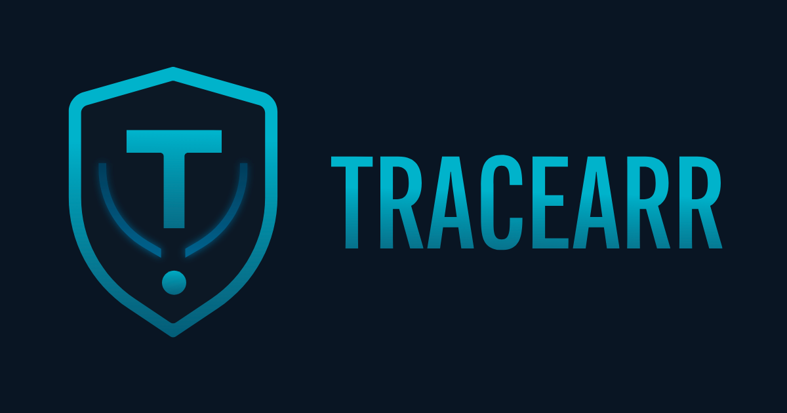

<p align="center">
  
</p>

<p align="center">
  <strong>Tracearr with Dispatcharr and Channels DVR support.</strong>
</p>

This is an unofficial fork of [Tracearr](https://github.com/connorgallopo/Tracearr) by Connor Gallopo. It adds two server types, [Dispatcharr](https://github.com/Dispatcharr/Dispatcharr) and [Channels DVR](https://getchannels.com/dvr-server/), alongside Tracearr's Plex, Jellyfin, Emby and tofa support. Dispatcharr support started in [d4rk-4lchemy's fork](https://github.com/d4rk-4lchemy/Tracearr), which this one builds on.

It is not supported by the Tracearr project. Please report problems with it [here](https://github.com/write-erase/Tracearr/issues), not upstream.

> [!WARNING]
> This image can replace an official Tracearr install in place, using the same database. **Back up first.** There is no guarantee that an update works on every setup.

## What Tracearr Does

Tracearr monitors Plex, Jellyfin, Emby and tofa servers from one dashboard: live streams, watch history, playback and library analytics, a stream map, account-sharing detection with trust scores, automations, notifications and newsletters. This fork is merged with each upstream release.

For the full feature tour, see [upstream's README](https://github.com/connorgallopo/Tracearr#readme), [tracearr.com](https://tracearr.com) and the manual at [docs.tracearr.com](https://docs.tracearr.com).

## Dispatcharr

- Support for Dispatcharr servers, with Login/Password (for WebSocket integration) or API Key auth,
- Shows currently running Live TV streams, as well as VOD Movies or VOD Shows,
- Allows you to discard streams from "Anonymous" user if you want,
- You can kill Dispatcharr streams directly from Tracearr dashboard,
- Live TV card is aligned to Dispatcharr needs, showing speed threshold, watchtime,
- Stream details for Live TV shows bitrate, codecs and video resolution,
- Support for Catch-Up (Timeshift) sessions, with small badge and custom card.
- A Dispatcharr card on the dashboard: connections in use per M3U account, an "Update available" pill, and what's streaming now with who's watching each channel (Anonymous viewers included, even when Anonymous streams are ignored for Now Playing). With a Channels DVR server selected too, the two cards share the row.

> [!NOTE]
> If you want to have "Server Resources" charts populated for Dispatcharr in Tracearr, you need to install this Dispatcharr plugin and align your Docker Compose file according to its README: [Tracearr SSE Metrics](https://github.com/d4rk-4lchemy/Tracearr-SSE-Metrics)

## Channels DVR

- Support for Channels DVR servers, with automatic active session detection (no credentials needed),
- Tracks Live TV, recordings and imported movies and shows, including playback in the Channels web player,
- Real playback position and pause detection, read from the Channels app on the device when it is on your network,
- Live TV progress and programme artwork from the guide,
- Library browsing for TV shows, movies and imported videos, with file sizes and links to open them in Channels DVR,
- The same episode on Channels DVR and another server shows as one item,
- Stop a stream on a device on your local network from the dashboard,
- A Channels DVR card on the dashboard: recordings in progress with exact times and a Stop button, recordings coming up in the next 24 hours, tuners in use and free disk space,
- Skip one episode of a series pass from Coming Up (and unskip it), or cancel a one-time recording,
- Alerts for a failed recording, a recording that resumes, a recording that loses its stream for a moment, and the DVR disk running low (at a percentage you choose, which also sets when the disk pill turns amber),
- Update checks for Channels DVR, following stable releases or pre-releases, with an "Update available" pill on the dashboard,
- Viewers show the device maker's logo (Apple, Amazon, Google, Android); the Channels Mac app shows as a Mac.

### Connecting

Connect your Channels DVR server using its base URL and port `8089` (for example, `http://192.168.1.100:8089`). No authentication credentials are required.

Channels DVR does not provide individual user accounts, so Tracearr identifies viewers by their client device name (or IP address). Two devices with the same name count as one viewer, so give each device its own name in Channels.

### Current Limitations

- Library browsing covers TV shows, movies and imported videos. Quality details (resolution, codecs, audio channels) are read from filename tags such as `[Bluray-720p][AC3 2.0][x264]`, so files without them show no quality info. File sizes come from Channels' `/dvr/files` list.
- Importing past watch history is not supported. Sessions Tracearr observes are still recorded in History.
- Streams can only be stopped when the playback device is on your local network and reachable from the Tracearr server (Tracearr calls the Channels app on the device at port 57000). Remote streams and the Channels web player cannot be stopped, and the optional termination message is not shown.
- Streams that reach Channels DVR through Tailscale Services into a Docker container in bridge mode cannot be stopped: Channels DVR sees the Docker gateway (`172.17.0.1`) instead of the device. In this setup Channels DVR can also report the Channels app on an iPhone as its web player, so that stream shows as "Web Browser" in Tracearr.
- The web player does not say which browser it runs in, and its pause state is detected about 20 seconds late.
- Recording alerts are checked once a minute, so an alert can arrive up to a minute after the event.
- The disk alert and the disk pill measure free space on the whole drive Channels records to, including anything else stored there.
- Session, schedule and alert detection rely on Channels DVR's undocumented endpoints (`/dvr`, `/dvr/jobs`, `/api/v1/jobs`, `/devices`, `/status`), so changes to them may affect compatibility.

## Mobile App

> [!NOTE]
> **Dispatcharr and Channels DVR servers don't appear in the Tracearr mobile app.** The app doesn't know these server types and stopped working when it got one, so Tracearr leaves them out of everything it sends the app: the server list, Now Playing, history, stats, users, alerts and push notifications. Your other servers work as usual. The Android app has not been tested.

The app is upstream's, so this fork can't change it, only what Tracearr sends to it. Cast your vote for the final decision in the [poll (#67)](https://github.com/write-erase/Tracearr/discussions/67).

## Installing

### Docker images

All images are on `ghcr.io/write-erase/tracearr`, for AMD64 and ARM64. Release images are built from the `main` branch for each release; development images are built from the `dev` branch.

| Tag                   | Description                                              |
| --------------------- | -------------------------------------------------------- |
| `latest`              | Latest release (requires external DB/Redis)              |
| `supervised-latest`   | All-in-one latest release                                |
| `3.2.1-r3`            | A pinned release (requires external DB/Redis)            |
| `supervised-3.2.1-r3` | All-in-one pinned release                                |
| `dev`                 | Built from the `dev` branch (requires external DB/Redis) |
| `supervised-dev`      | All-in-one, built from the `dev` branch                  |

The supervised image bundles the app, TimescaleDB and Redis in one container and generates its own secrets on first boot. The standalone image needs `timescale` and `redis` deployed alongside it.

Dispatcharr-only images from the fork this one builds on are published by d4rk-4lchemy as `ghcr.io/d4rk-4lchemy/distracearr` (and `darkalchemy2137/distracearr`); they do not include Channels DVR support.

### Quick Start

```bash
# Download compose file
curl -O https://raw.githubusercontent.com/write-erase/Tracearr/main/docker/examples/docker-compose.pg18.yml

# Use this fork's image instead of the official one
sed -i.bak 's#ghcr.io/connorgallopo/tracearr:latest#ghcr.io/write-erase/tracearr:latest#' docker-compose.pg18.yml

# Generate secrets
echo "JWT_SECRET=$(openssl rand -hex 32)" > .env
echo "COOKIE_SECRET=$(openssl rand -hex 32)" >> .env

# Deploy
docker compose -f docker-compose.pg18.yml up -d
```

Open `http://localhost:3000` and connect your servers.

The [Docker Compose examples](docker/examples/README.md) cover the supervised image and other setups. They name the official image, so use one of the images above in its place.

### Switching back to the official image

If you have already added a Dispatcharr or Channels DVR server and stored data from its sessions, run the corresponding command **while you are still using this forked image**. After running the appropriate command, you can stop this container and replace the image with the official Tracearr image.

**To remove Dispatcharr data:**

`docker exec -it {tracearr_container_name} node apps/server/dist/scripts/purge-dispatcharr.js`

**To remove Channels DVR data:**

`docker exec -it {tracearr_container_name} node apps/server/dist/scripts/purge-channels-dvr.js`

Add `-y` to either command to skip the confirmation prompt. If you used both integrations, run both commands.

### Viewing Logs

**Standard Docker** - Each service runs in its own container:

```bash
docker logs tracearr          # Application logs
docker logs tracearr-postgres # Database logs
docker logs tracearr-redis    # Cache logs
```

**Supervised Docker** - All services run in one container. View logs in the web UI at `/debug` (Log Explorer section), or via CLI:

```bash
docker exec tracearr cat /var/log/supervisor/tracearr-error.log
```

Available log files: `tracearr.log`, `tracearr-error.log`, `postgres.log`, `postgres-error.log`, `redis.log`, `redis-error.log`, `supervisord.log`

Set `LOG_LEVEL=debug` for verbose output.

## Building and Development

### Building your own image

The stream map basemap is generated during a local Docker build if
`data/basemap.pmtiles` is missing. The first build downloads the pinned
Protomaps extract (about 550 MB) and needs network access; run `pnpm basemap`
beforehand if you want to reuse the archive across image builds.

```bash
# Standalone image
docker build -f docker/Dockerfile -t tracearr \
  --build-arg APP_VERSION=3.2.1 --build-arg APP_TAG=v3.2.1-r3 \
  --build-arg APP_UPSTREAM_VERSION=3.2.1 --build-arg APP_FORK_REVISION=3 --build-arg APP_FORK_VERSION=3.2.1-r3 \
  --build-arg APP_FORK_REPO=write-erase/Tracearr --build-arg APP_IMAGE_REPO=ghcr.io/write-erase/tracearr \
  --build-arg APP_COMMIT="$(git rev-parse --short HEAD)" --build-arg APP_BUILD_DATE="$(date -u +%Y-%m-%dT%H:%M:%SZ)" .

# Supervised image
docker build -f docker/Dockerfile.supervised -t tracearr-supervised \
  --build-arg APP_VERSION=3.2.1 --build-arg APP_TAG=supervised-3.2.1-r3 \
  --build-arg APP_UPSTREAM_VERSION=3.2.1 --build-arg APP_FORK_REVISION=3 --build-arg APP_FORK_VERSION=3.2.1-r3 \
  --build-arg APP_FORK_REPO=write-erase/Tracearr --build-arg APP_IMAGE_REPO=ghcr.io/write-erase/tracearr \
  --build-arg APP_COMMIT="$(git rev-parse --short HEAD)" --build-arg APP_BUILD_DATE="$(date -u +%Y-%m-%dT%H:%M:%SZ)" .
```

### Development setup

```bash
# Install dependencies (requires pnpm 12+, Node.js 26.13+)
pnpm install

# Start database services
docker compose -f docker/docker-compose.dev.yml up -d
# Includes Mailpit for email testing: SMTP on 1025, inbox at http://localhost:8025

# Copy and configure environment
cp .env.example .env

# Run migrations
pnpm --filter @tracearr/server db:migrate

# Build the stream map basemap (about 550 MB, once)
pnpm basemap

# Start dev servers
pnpm dev
```

Frontend runs at `localhost:5173`, API at `localhost:3000`. Tests need `TZ=UTC`.

[FORK_INFO.md](FORK_INFO.md) records each change this fork makes and why.

## Reporting Problems

Problems with Dispatcharr or Channels DVR, or anything that only happens on this fork: [open an issue here](https://github.com/write-erase/Tracearr/issues). Problems that also happen on the official image belong [upstream](https://github.com/connorgallopo/Tracearr/issues).

## License

[AGPL-3.0](LICENSE), the same as upstream Tracearr. This fork's source is published here under the same license.

This product includes GeoLite2 data created by MaxMind, available from https://www.maxmind.com.
